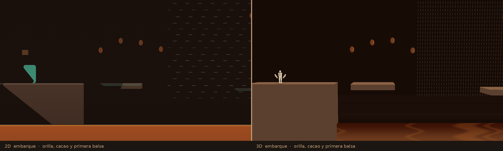
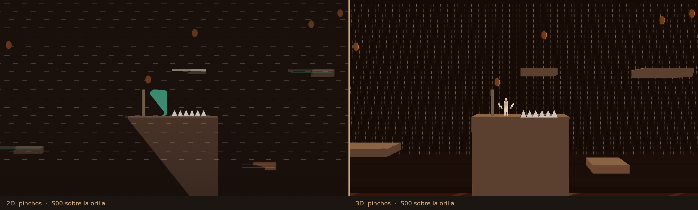
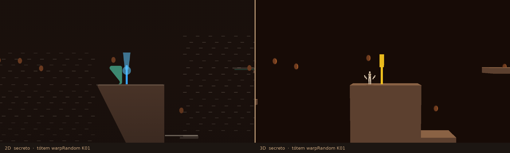
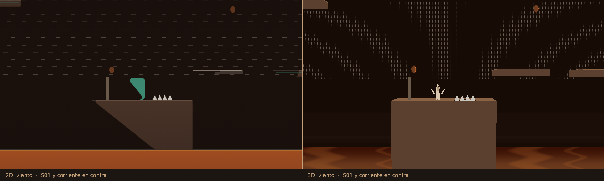
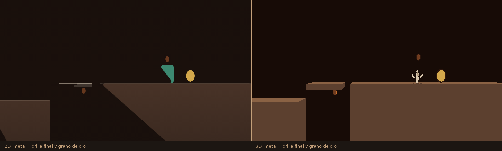

# Río de Chocolate — comparativo 2D | 3D

Nivel 2D `rio-1` (mundo `rio`, «Río de Chocolate / Balsas de caramelo»). Es el único `rio-*` en `createLevels()`. No hay `rio-2`.

Escala: 24 px = 1 m. En 2D y crece hacia abajo. En Godot el techo de una caja es `(896 − y_px) / 24` y el centro x es `(x + w/2) / 24`. Los movers usan la fórmula de `sim.ts`: `t = time·τ/period + phase`, `nx = ox + sin(t)·ax`, `ny = oy + cos(t)·ay`. En t = 0 un raft vertical no está en `oy`.

## Fuente

El pin pedido `NadiaCoelloO/sand-vivid-dawn-sail@5fd45031` responde 404 desde este entorno. El layout se leyó, sin escribir, de `NadiaCoelloO/Cacao.Game@77e55b5278` (`levels.ts` `make("rio-1")` y `sim.ts`). Los números de abajo salen de ese archivo, volcados en `runtime/data/rio1_layout.json`.

## Cámara

`camera_offset` va después de `script =` en `pilot_rio.tscn` y se vuelve a fijar en `_ready`. `player_maya.gd` no se tocó.

| | valor |
| --- | --- |
| offset | `(0, 1, 24.1256)` |
| fov | 50°, alto constante, viewport 1280×720 |
| alto de fórmula `2·24.1256·tan(25°)` | 22.4999 m |
| plano z = 0 medido | 22.5470 × 40.0342 m |
| Maya (1.75 m) | 55.68 px en los cinco encuadres |

`kill_y` de Maya queda en −1000. La caída que resta vida la aplica la escena cuando los pies bajan de `−(80+42)/24 = −5.083 m`, la misma regla de 80 px bajo el nivel.

## Encuadres

2D es `renderGame` a 960×540, con los movers ya en la pose t = 0 de `sim.ts` (el preview no avanza el tiempo). 3D es el viewport 1280×720. La barra central de cada PNG es de 5 px.

| id | pies 3D (m) | foco 2D (px) | qué se compara |
| --- | --- | --- | --- |
| embarque | (4.542, 10.667) | (96, 598) | orilla, arco de cacao, primera balsa |
| pinchos | (57.000, 13.333) | (1355, 534) | pinchos S00 y el one-way de arriba |
| secreto | (96.200, 21.333) | (2296, 342) | tótem K01 `warpRandom` |
| viento | (136.500, 10.667) | (3263, 598) | pinchos S01 y el viento de vuelta |
| meta | (194.500, 21.333) | (4655, 342) | orilla final y el grano de la meta |











En t = 0 el 2D pinta el frame azul del tótem secreto (`#3aa7ff`, haz cian). El 3D usa el frame dorado `#f0c020` de la misma animación, para no meter un acento cian en el río.

## Plataformas

Ancho del nivel: 4992×896 px (208 × 37.333 m). Agua visual en y = 800 px → 4 m. `canSwim` es false: no hay nado ni aire.

| id | tipo | rect 2D (x, y, w, h) px | x 3D (m) | techo (m) | movimiento |
| --- | --- | --- | --- | --- | --- |
| P00 | solid | (0, 640, 320, 256) | 0–13.333 | 10.667 | — |
| P01 | moving | (384, 640, 160, 22) | 6.667–32.000 | 10.667 | ax 224, ay 0, T 3.4, fase 0 |
| P02 | moving | t0 (896, 659.37, 160, 22) | 37.333–44.000 | 9.333–22.667 | ax 0, ay 160, T 3.8, fase 0.4; techo t0 9.860 |
| P03 | solid | (1280, 576, 256, 320) | 53.333–64.000 | 13.333 | — |
| P04 | oneway | (1408, 448, 96, 18) | 58.667–62.667 | 18.667 | — |
| P05 | crate | (1600, 704, 96, 22) | 66.667–70.667 | 8.000 | plataforma real; Maya no tiene pound |
| P06 | moving | (1728, 448, 128, 22) | 61.333–88.000 | 18.667 | ax 256, ay 0, T 2.9, fase 0 |
| P07 | solid | (2240, 384, 256, 512) | 93.333–104.000 | 21.333 | — |
| P08 | oneway | (2496, 576, 128, 22) | 104.000–109.333 | 13.333 | — |
| P09 | moving | t0 (2752, 320, 160, 22) | 114.667–121.333 | 8.000–24.000 | ax 0, ay −192, T 3.2, fase 0; techo t0 24.000 |
| P10 | solid | (3136, 640, 320, 256) | 130.667–144.000 | 10.667 | — |
| P11 | oneway | (3456, 544, 160, 20) | 144.000–150.667 | 14.667 | — |
| P12 | moving | t0 (3712, 544, 160, 22) | 148.000–174.667 | 12.000–22.667 | ax 160, ay 64, T 3.6, fase 0; techo t0 14.667 |
| P13 | solid | (3968, 448, 256, 448) | 165.333–176.000 | 18.667 | — |
| P14 | oneway | (4256, 384, 128, 20) | 177.333–182.667 | 21.333 | — |
| P15 | solid | (4416, 384, 576, 512) | 184.000–208.000 | 21.333 | orilla de la meta |

Los rangos x de un mover son el barrido completo, no la pose de reposo. P01 en reposo ocupa 16–22.667 m y se solapa con la orilla cuando `sin` es negativo. Drop-through: el one-way se apaga mientras `_drop_timer` (0.18 s) está activo y los pies están bajo el techo. El mantle de Maya sigue viendo los one-way; excluirlos pide editar `player_maya.gd`, y no se editó.

## Peligros

| id | tipo | rect 2D px | en 3D |
| --- | --- | --- | --- |
| L00 | lava | (0, 800, 4992, 128) | lámina vertical de todo el AABB, z = −0.45, sin colisión. Techo a 4 m. Mata. No es un piso. |
| S00 | spikes | (1408, 558, 96, 18) | sobre P03, x 58.667–62.667, alto 0.75 m, dibujados al hitbox |
| S01 | spikes | (3328, 622, 64, 18) | sobre P10, x 138.667–141.333, alto 0.75 m |
| W00 | wind | (640, 256, 1600, 448), vx 160 | x 26.667–93.333, y 8–26.667 |
| W01 | wind | (2560, 192, 1280, 384), vx −140 | x 106.667–160, y 13.333–29.333 |

El viento suma `(vx/mass)·dt` a la velocidad y el mismo paso a la posición, como `applyWind` antes de `resolveX`. `mass = 1`. Si Maya mantiene una dirección, `applyRun` la devuelve al objetivo de carrera en el tick siguiente: el extra sostenido es un frame (~2.67 px/s con vx 160). No mata. Las ráfagas van en un quad detrás del plano de juego (z = −1.8).

## Cacao, tótems, meta

19 granos. El radio de recogida es 28 px al centro del cuerpo, igual que `sim.ts`. Elipse 2D 16×22 px a 540p → ~21×29 px a 720p. El mesh mide 21.4×29.6 px (C00 en embarque, píxel 511, 252).

| | medido en embarque | pedido |
| --- | --- | --- |
| cuerpo | (112, 60, 31) | `#6b3a1f`–`#8B4A2B` |
| rim 3/4 | (206, 114, 45) | `#CE722E` (206, 114, 46) |
| outline | (43, 21, 11) | `#2c1810` |

| id | centro 2D (px) | centro 3D (m) |
| --- | --- | --- |
| C00–C03 | arco (384, 512) → (614, 512), lift 36 | (16, 16) → (25.6, 16) |
| C04 | (960, 384) | (40, 21.333) |
| C05 | (1344, 480) | (56, 17.333) |
| C06 | (1472, 352) | (61.333, 22.667) |
| C07–C10 | arco (1792, 320) → (2032, 320), lift 28 | (74.667, 24) → (84.667, 24) |
| C11 | (2304, 288) | (96, 25.333) |
| C12 | (2560, 480) | (106.667, 17.333) |
| C13 | (2816, 320) | (117.333, 24) |
| C14 | (3200, 544) | (133.333, 14.667) |
| C15 | (3584, 352) | (149.333, 22.667) |
| C16 | (3904, 256) | (162.667, 26.667) |
| C17 | (4352, 416) | (181.333, 20) |
| C18 | (4672, 288) | (194.667, 25.333) |

| id | rect 2D px | spawn de los pies (m) | uso |
| --- | --- | --- | --- |
| K00 | (1312, 504, 36, 72) | (55.375, 13.333) | poste normal. Un salto nuevo graba el spawn. |
| K01 | (2336, 312, 36, 72) | (98.042, 21.333) | `warpRandom`. El segundo salto nuevo registra `RIO_WARP world=secret level=stub no 3D scene`, reaparece en el último spawn, no gasta vida y no congela. No hay escena 3D del destino. |
| K02 | (3168, 568, 36, 72) | (132.708, 10.667) | poste normal |
| G00 | (4736, 328, 48, 56) | centro (198.333, 22.500) | meta cacao. El grano visible sigue la elipse de fallback 16×22 px (`#d4a84b`); el trigger es el AABB entero. |

El chequeo de warp, con el salto mantenido, imprimió un solo `RIO_WARP` y siguió en `status=playing`, vidas 5, x = 98.04.

## Contraste

p10 del interior de Maya contra el frame sin ella. Diferencia de color > 36, dos erosiones 3×3, y se pide vecindad de 4. WCAG tras linealizar sRGB. Sin el borde antialias y sin halo pegado.

| encuadre | interior | p10 | mín | cuerpo mediano | fondo p10 |
| --- | --- | --- | --- | --- | --- |
| embarque | 262 | 7.34 | 5.08 | (213, 195, 170) | (23, 11, 6) |
| pinchos | 124 | 5.17 | 2.35 | (182, 159, 130) | (23, 11, 6) |
| secreto | 124 | 5.29 | 5.29 | (182, 159, 130) | (23, 11, 6) |
| viento | 124 | 5.29 | 5.29 | (182, 159, 130) | (23, 11, 6) |
| meta | 169 | 7.55 | 5.27 | (182, 159, 130) | (23, 11, 6) |

Todos los p10 están sobre 4.4. El mínimo 2.35 de pinchos son tres píxeles del borde contra el labio de la orilla; no se les añadió un halo.

## Probe

`RIO_PROBE=1` con `--headless --fixed-fps 60`. Solo inputs. Dos corridas seguidas dieron la misma línea:

`RIO_PROBE result=win t=28.97 x=196.89 y=21.33 lives=4 coins=3 deaths=1 reason=goal`

La muerte es una caída al río en x = 36.70, y = 3.36 (el hueco entre P01 y P02, justo antes del raft vertical). Reaparece en el spawn, vuelve a subir y llega a la meta. No hay cara vertical que pida wall hop. MOVE-001 no bloquea `rio-1`: el tag del 2D («el último tramo sí se alcanza») se cumple con carrera, salto y doble salto. El probe no recoge los 19 granos; la meta no los exige.

## Rendimiento

OpenGL 3, 1280×720, primitivas y draws visibles.

| encuadre | tris | draws | tris del mundo | draws del mundo |
| --- | --- | --- | --- | --- |
| embarque | 3789 | 31 | 2434 | 22 |
| pinchos | 4021 | 36 | 2666 | 27 |
| secreto | 4447 | 35 | 3092 | 26 |
| viento | 2713 | 29 | 1358 | 20 |
| meta | 2915 | 19 | 1560 | 10 |

## sha256

```
e9d747c9213097df9dd46bfcb74b08eb407a923deb3689d91d5a987e8467f976  cmp_embarque.png
1238ff0a1f3c28ca4a288709479906677c3b3f84bb4b17d5d0c67792eba182a9  cmp_pinchos.png
78a69c13c3836a87450cef5491e2bf32c5f6657284182a3e18672c917c6a0b14  cmp_secreto.png
1271f0c10fd23366ed37dda8c04ac82513622ccac23799a7a1cde568e1ab1627  cmp_viento.png
ab03b228588f0a820b4a580cb872ec10a4b68bb4ab026bb6b452b268c06b4fd5  cmp_meta.png
```
